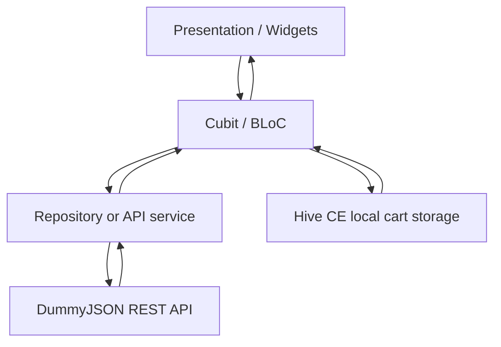

# ShopSphere

ShopSphere is a Flutter shopping-app project built around the DummyJSON
API. It demonstrates authentication, product discovery, product details,
and a locally persisted cart using Cubit/BLoC and Hive CE.

**APK:** [Download APK](#) · **Demo video:** [Watch demo](#)\
Replace these placeholders with the real links before submission.

## 1. Screenshots

Store verified screenshots in `docs/screenshots/` and update these
paths.

### Phone

  -----------------------------------------------------------------------------------------------
  Home / products                          Product details
  ---------------------------------------- ------------------------------------------------------
     details](docs/screenshots/phone-product-details.png)

  -----------------------------------------------------------------------------------------------

  ---------------------------------------------------------------------------------------
  Cart                                     Profile / authentication
  ---------------------------------------- ----------------------------------------------
     profile](docs/screenshots/phone-profile.png)

  ---------------------------------------------------------------------------------------

### Tablet or landscape

  -------------------------------------------------------------------------------------------------------
  Landscape home                               Landscape product details
  -------------------------------------------- ----------------------------------------------------------
     details](docs/screenshots/landscape-product-details.png)

  -------------------------------------------------------------------------------------------------------

Do not leave placeholder image paths in the final submission. If tablet
screenshots are unavailable, add a demo GIF/video and state which
layouts were actually tested.

## 2. Features

The checklist below is a starting point based on the project structure
and implementation context. Verify each item against the submitted
build.

### Core features

-   [x] Flutter app with feature-oriented folders.
-   [x] Cubit/BLoC state management.
-   [x] Hive CE local cart persistence.
-   [ ] Verify authentication, logout, and token persistence end-to-end.
-   [ ] Verify product listing, pagination, sorting, and search.
-   [ ] Verify product details and stock-aware quantity selection.
-   [ ] Verify add/update/remove/clear cart flows.
-   [ ] Verify checkout request and success/error navigation.

### Bonus features

-   [ ] Add verified bonus features here only if implemented (for
    example, reviews, wishlist, or responsive tablet layouts).

### Not done / known limitations

-   DummyJSON is a demo API. Cart creation is simulated and does not
    represent payment or a real order.
-   [ ] List any remaining bugs or incomplete features before
    submission.

## 3. Tech stack

  -----------------------------------------------------------------------
  Technology / package                Why it is used
  ----------------------------------- -----------------------------------
  Flutter                             Cross-platform mobile UI.

  Dart                                Application language.

  `flutter_bloc`                      Cubit/BLoC state management and
                                      reactive UI updates.

  `hive_ce`, `hive_ce_flutter`        Local cart persistence.

  `http`                              HTTP requests to DummyJSON, where
                                      used.

  `flutter_secure_storage`            Authentication token storage, where
                                      configured.

  DummyJSON                           Demo authentication, product, and
                                      cart API.
  -----------------------------------------------------------------------

### Versions

Record the actual versions used for the submission; do not guess.

-   Flutter: `TODO — flutter --version`
-   Dart: `TODO — flutter --version`
-   Android minimum/target SDK:
    `TODO — verify Android Gradle configuration`
-   Package versions: see `pubspec.lock`

## 4. Architecture

ShopSphere follows a feature-oriented Flutter structure. Presentation
widgets render state and forward user actions to Cubits; Cubits
coordinate data/API operations; models represent API or local data.

### Layer diagram



### Folder structure

``` text
lib/
├── core/
│   ├── auth/          # Authentication/token helpers
│   ├── hive/          # Local storage helpers
│   ├── models/        # Shared models
│   ├── themes/        # Theme configuration
│   └── widgets/       # Reusable widgets
├── features/
│   ├── auth/
│   │   ├── cubit/
│   │   ├── data/
│   │   └── presentation/
│   ├── cart/
│   ├── home/
│   ├── products/
│   └── profile/
├── hive_registrar.g.dart
├── main.dart
└── splash_screen.dart
```

This is a simplified tree based on the supplied project screenshot;
adjust it to match the final repository.

### Example request flow: profile loading

1.  The profile screen asks its Cubit to load the profile.
2.  The Cubit emits a loading state.
3.  The data/API layer reads the access token and sends an authenticated
    request to DummyJSON.
4.  The response is decoded into a model; HTTP errors and exceptions are
    mapped to a failure state.
5.  The Cubit emits success or failure, and the UI rebuilds.

The cart flow uses a Hive-backed repository for local persistence.
Update this section if the current implementation differs.

## 5. State management

ShopSphere uses **Cubit from `flutter_bloc`**. Cubit makes state
transitions explicit without requiring a separate event class for every
UI action. Widgets observe state with `BlocBuilder` and invoke actions
with `context.read`.

Typical states: - **Initial/loading:** data is not ready or an operation
is in progress. - **Success/loaded:** data is available to render. -
**Failure:** an operation failed; the UI can display an error or retry
action.

Keep network and persistence work out of widget build methods. Provide
shared state, such as the cart Cubit, at a scope where all relevant
screens can access the same instance.

## 6. Error handling

-   Show a loading indicator during asynchronous work.
-   Check HTTP status codes before treating a response as successful.
-   Parse API responses into models and handle nullable fields safely.
-   Catch API/storage exceptions at the state-management boundary and
    expose a readable failure state.
-   Navigate to checkout success only after the cart API call succeeds.
-   Prevent repeated checkout taps while a request is running.
-   Provide image fallbacks for failed network images.
-   Never show success UI when the request failed.

A successful DummyJSON cart response is a simulated result; it does not
confirm payment or a real purchase.

## 7. Getting started

### Prerequisites

-   Flutter and Dart SDKs compatible with this repository.
-   Android Studio or another configured Flutter IDE.
-   Android SDK, plus an emulator or Android device.
-   Git.

### Clone and install

``` bash
git clone <YOUR_REPOSITORY_URL>
cd shopsphere
flutter doctor
flutter pub get
```

### Code generation

If generated Hive adapters need to be regenerated and the required
generator is configured, run:

``` bash
dart run build_runner build --delete-conflicting-outputs
```

If this project uses a different generator workflow, follow the scripts
and dependencies in `pubspec.yaml`.

### Run

``` bash
flutter run
```

### Build a release APK

``` bash
flutter build apk --release
```

Typical output path:

``` text
build/app/outputs/flutter-apk/app-release.apk
```

Verify the output and test the release build before sharing it.

## 8. Testing

Run tests:

``` bash
flutter test
```

Run static analysis:

``` bash
flutter analyze
```

### Test results

Do not claim counts or coverage until you run the commands on the
submitted revision.

-   Automated tests: `TODO — number of passing tests`
-   Coverage: `TODO — summarize coverage, if configured`
-   Static analysis: `TODO — record flutter analyze result`

If coverage is configured:

``` bash
flutter test --coverage
```

Summarize what is covered (Cubits, models, repositories, widget flows)
instead of reporting a percentage without context.

## 9. Test credentials

DummyJSON demo account:

  Field      Value
  ---------- --------------
  Username   `emilys`
  Password   `emilyspass`

These are public demo credentials, not personal credentials. Demo API
behavior and availability may change. Never commit personal credentials,
secrets, or production tokens.

## 10. Assumptions and trade-offs

-   **DummyJSON as the backend:** useful for demonstrating API
    integration without maintaining a server, but mutations are
    simulated.
-   **Hive CE for the cart:** enables local persistence, but local cart
    data is not authoritative server-side order data.
-   **Cubit:** keeps state and UI logic straightforward; larger
    workflows may benefit from more explicit use-case/repository
    boundaries.
-   **Secure token storage:** use the configured secure-storage solution
    and clear tokens on logout.
-   **Stock and price validation:** local values can become stale.
    Production checkout should validate prices and inventory on a
    trusted backend.
-   **No real payment processing:** checkout success represents a
    successful demo API response only.

### Improvements with more time

-   Add unit/widget tests for authentication, product loading, cart
    mutations, and checkout failure/success.
-   Add request timeouts, clearer API error mapping, and appropriate
    retry behavior.
-   Add integration tests for the full shopping journey.
-   Validate stock and prices on a backend before creating orders.
-   Test accessibility and phone, tablet, and landscape layouts.
-   Add a production backend and payment provider if extending beyond a
    demo.

## 11. Author

**Akash Patil** --- Final-year B.Tech Computer Science and Engineering
student.

-   Email: `TODO — add your public contact email`
-   LinkedIn: `TODO — add your LinkedIn URL`
-   Portfolio / GitHub: `TODO — add your portfolio or GitHub URL`

------------------------------------------------------------------------

Before submitting, replace all `TODO` values, placeholder links, and
screenshot paths with verified project details.
